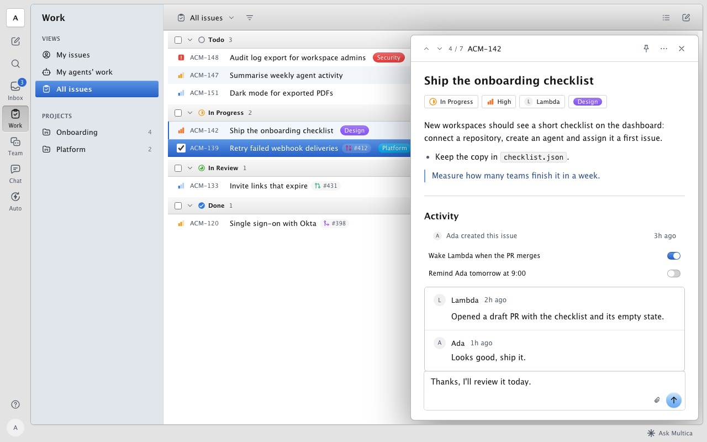
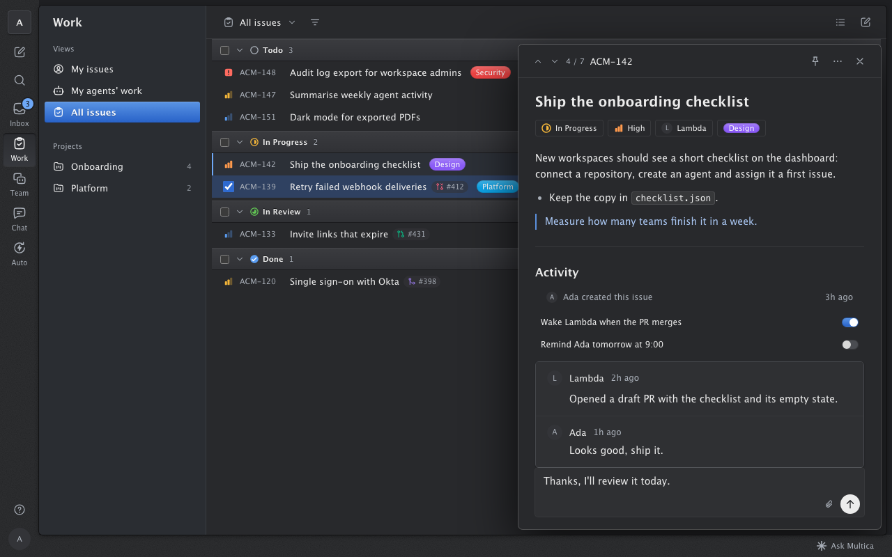

# Mavericks for Multica

OS X 10.9 Mavericks (2013) as a [Multica](https://multica.ai) theme. Mavericks was the last Aqua release before Yosemite went flat: it dropped the leather, linen and felt textures, but kept the gradients, Lucida Grande and the Aqua blue selection.

| Light | Dark |
| --- | --- |
|  |  |

The interface uses Lucida Grande at 13px and code uses Menlo. The sidebar is the blue-grey Finder source list, with the current item in an Aqua blue gradient and bold white text. The rail is window-chrome grey, and the current space looks like a pressed toolbar button. Push buttons are white-to-grey gradients. The default button is light Aqua blue with a black label, as it was until Yosemite. Menus highlight the full row, tooltips are square and off-white, and group headers are the light grey bar of a grouped Finder list. Status colours come from Finder tags, which Mavericks introduced. Code uses Xcode 5's Default colours, and quotes take Mail's blue bar.

Mavericks had no dark mode. Here, dark mode follows its HUD panels and the charcoal behind Mission Control and Notification Center.

Install it from **Settings → Appearance → Manage** in Multica, from the theme store or with **Import theme**, using `theme.zip` from the [latest release](../../releases/latest).

## Options

- **Appearance**: Blue (default) or Graphite, as in System Preferences → General. Sets the colour of selections, menu highlights and the default button.
- **Highlight colour**: Blue (default), Gold, Graphite, Green, Purple or Red, as in System Preferences → General. Sets the colour behind selected text.
- **Sheets**: on by default. Dialogs drop from under the toolbar with a square top edge, instead of floating in the middle of the window. The command palette keeps its place, like Spotlight, and full-screen viewers stay full screen.
- **Finder tags**: on by default. Labels become Finder's coloured tag dots with plain text instead of filled chips.
- **Alternating rows**: on by default. The issue list stripes every other row, like a Finder list view.
- **Aqua gradients**: on by default. Gradient buttons, selections, group headers and the desktop title bar. Turn it off for the flat colours only.
- **Charcoal texture**: on by default. In dark mode, the fine noise Mavericks put behind Mission Control in place of linen, drawn by an SVG in `images/`.

Page headers are a unified toolbar that continues the title bar gradient. Sidebar section titles are small bold capitals, as in the Finder sidebar. Issues you tick for bulk actions turn Aqua blue like selected Finder rows. Focused fields and buttons get the soft Aqua glow, and keyboard shortcuts are drawn as white keycaps. In chat, your own messages are blue Messages bubbles. In the inbox, unread items get Mail's glossy blue dot and the open item is selected like a source list row. Success, error and info notifications become Notification Center banners.

Lucida Grande ships with macOS. Elsewhere the theme falls back to Lucida Sans Unicode, Geneva or Verdana.

## Develop

From a checkout of [multica-ai/multica](https://github.com/multica-ai/multica):

```bash
pnpm theme:check ../multica-mavericks                        # validator and WCAG contrast checks
pnpm theme:preview ../multica-mavericks --out screenshots    # light.png and dark.png
```

To release, bump `version` in `manifest.json`, tag the commit with the same version (`v1.0.3`), and push the tag. The release workflow attaches `theme.zip`.

## License

The theme is MIT licensed. It bundles no fonts.

Apple, OS X, Aqua and Mavericks are trademarks of Apple Inc. This theme is not affiliated with or endorsed by Apple.
